# Rust for PHP & Laravel Developers: The Zero-to-Production Guide

Welcome to the definitive Rust learning curriculum designed specifically for **PHP and Laravel developers**.

In PHP, the Zend Engine's garbage collector, dynamic typing, and PHP-FPM's shared-nothing process model abstract away hardware memory, pointers, and threads. In Rust, you write high-level, expressive code that compiles down to raw, zero-overhead machine instructions.

This curriculum bridges the exact mental models you already know from modern PHP 8 and Laravel (Dependency Injection, Service Containers, Eloquent, Queues, FormRequests, Middleware, Pest/PHPUnit) directly to their idiomatic Rust equivalents.

---

## 🗺️ Visual Curriculum Roadmap

```mermaid
flowchart TD
    subgraph Fundamentals["Phase 1: The Core Mental Shift"]
        M0["00. Tooling & Environment<br/><i>rustup, cargo vs composer/artisan</i>"]
        M1["01. Language Basics<br/><i>Types, mut, expressions vs statements</i>"]
        M2["02. Ownership & Borrowing<br/><i>Stack vs Heap, Move semantics, & vs &mut</i>"]
        M3["03. Compound Types & Matching<br/><i>Structs, Tagged Unions, match, let-else</i>"]
        M4["04. Error Handling<br/><i>Killing null & exceptions: Option, Result, ?</i>"]
        M5["05. Traits & Generics<br/><i>Interfaces & traits, composition over inheritance</i>"]
        M6["06. Collections & Iterators<br/><i>Vec, HashMap, lazy iterators vs Laravel collections</i>"]
    end

    subgraph Intermediate["Phase 2: Mastering Memory & Concurrency"]
        M7["07. Lifetimes Demystified<br/><i>Borrow scope, 'a, lifetime elision</i>"]
        M8["08. Smart Pointers & Shared State<br/><i>Box, Rc, Arc, RefCell, Mutex, RwLock</i>"]
        M9["09. Async & Concurrency<br/><i>Tokio async vs PHP-FPM, green tasks, mpsc channels</i>"]
    end

    subgraph Advanced["Phase 3: Production Backend Engineering"]
        M10["10. Web Backend: Laravel to Axum<br/><i>Routing, Extractors, State, SQLx vs Eloquent</i>"]
        M11["11. Clean Architecture & Production<br/><i>Hexagonal layers, tracing, 15MB Docker containers</i>"]
        M12["12. Testing & Quality<br/><i>Pest vs cargo test, integration tests, mocks</i>"]
        M13["13. Practical Production Projects<br/><i>Artisan CLI, Axum REST API, Async Queue Worker</i>"]
    end

    Fundamentals --> Intermediate --> Advanced
```

---

## 📚 Curriculum Table of Contents

| # | Module | Core Concept | Direct Link |
|---|---|---|---|
| **00** | **Tooling & Setup** | `rustup`, `cargo`, `rustc`, `clippy`, Composer vs Cargo commands | [00-tooling-and-setup](00-tooling-and-setup/README.md) |
| **01** | **Basics: PHP vs Rust** | Variables, `mut`, Scalar types, Shadowing, Expressions vs Statements | [01-basics-php-vs-rust](01-basics-php-vs-rust/README.md) |
| **02** | **Ownership & Borrowing** | Stack vs Heap, Move semantics, References `&` and `&mut`, Copy types | [02-ownership-and-borrowing](02-ownership-and-borrowing/README.md) |
| **03** | **Structs & Enums** | DTOs as Structs, Tagged Unions, `match`, `if let`, `let-else` guards | [03-structs-enums-pattern-matching](03-structs-enums-pattern-matching/README.md) |
| **04** | **Error Handling** | Killing `null` with `Option<T>`, Killing Exceptions with `Result<T, E>`, `?` operator | [04-error-handling](04-error-handling/README.md) |
| **05** | **Traits & Generics** | Polymorphism without inheritance, Trait bounds, `impl Trait`, `dyn Trait` | [05-traits-and-generics](05-traits-and-generics/README.md) |
| **06** | **Collections & Iterators** | `Vec`, `HashMap`, `String` vs `&str`, Lazy Iterators vs Laravel Collections | [06-collections-and-iterators](06-collections-and-iterators/README.md) |
| **07** | **Lifetimes Demystified** | References scope, Preventing dangling pointers, Lifetime elision, Struct lifetimes | [07-lifetimes-and-references](07-lifetimes-and-references/README.md) |
| **08** | **Smart Pointers & State** | `Box<T>`, `Rc<T>`, `Arc<T>`, `RefCell<T>`, `Mutex<T>`, `RwLock<T>` | [08-smart-pointers-and-memory](08-smart-pointers-and-memory/README.md) |
| **09** | **Async & Concurrency** | PHP-FPM vs Tokio async event loop, `tokio::spawn`, MPSC channels | [09-async-and-concurrency](09-async-and-concurrency/README.md) |
| **10** | **Web Backend (Axum)** | Axum routing, extractors (FormRequest equivalent), State DI, SQLx vs Eloquent | [10-web-backend-laravel-to-axum](10-web-backend-laravel-to-axum/README.md) |
| **11** | **Clean Architecture** | Hexagonal architecture, DTOs, structured logging (`tracing`), multi-stage Docker | [11-production-patterns-and-clean-arch](11-production-patterns-and-clean-arch/README.md) |
| **12** | **Testing & Benchmarks** | Pest vs `cargo test`, unit tests in `src/`, integration tests in `tests/`, mocks | [12-testing-and-benchmarking](12-testing-and-benchmarking/README.md) |
| **13** | **Practical Projects** | 1. Artisan-Style CLI (`clap`) 2. Axum JSON REST API 3. Async Job Worker (Queue) | [13-practical-projects](13-practical-projects/README.md) |

---

## ⚡ Instant Reference
- **The Rosetta Stone (PHP to Rust Dictionary)**: [php-to-rust-dictionary.md](cheat-sheets/php-to-rust-dictionary.md)

---

## 💡 The Top 5 PHP Habits to Unlearn in Rust

1. **Don't search for `null`**: You cannot have an uninitialized or null variable in Rust. Wrap optional data in `Option<T>` (`Some(val)` or `None`).
2. **Don't use `try/catch` for control flow**: In Rust, errors are ordinary data returned via `Result<T, E>`. Use the `?` operator to bubble them up.
3. **Values are MOVED by default, not copied**: In PHP, assigning an array or passing a variable copies it (Copy-on-Write). In Rust, passing a `String` or struct to a function transfers ownership. If you still need it, pass a reference (`&my_var`).
4. **Composition over Inheritance**: There is no `class` and no `extends`. Combine data in a `struct` and implement shared behaviors with `trait`.
5. **No shared-nothing restart**: In PHP-FPM, all memory is wiped after each HTTP request. In Rust, your web server is a single, permanent, multi-threaded binary. Shared caches, connection pools, and in-memory state stay alive across requests.
